
<a name="terminal"></a>
<a name="quote"></a>
<a name="project-detectivebox"></a>
<a name="project-jexplore"></a>
<a href="https://www.plai.fr/"></a>
<a name="project-royal-canin"></a>
<a name="project-jsa-bmb"></a>
<a href="https://ffmm-ecv-25-26.vercel.app/"></a>
<a href="https://bgcleaner.vercel.app/"></a><a href="https://astro-three-flax.vercel.app/"></a>
<a name="stack"></a>
<a name="stats"></a>
<a name="contact"></a>
<a href="mailto:bermudezpierre@gmail.com?subject=Let%27s%20grab%20a%20coffee"></a><a href="https://www.linkedin.com/in/pierre-bermudez-b6247891/"></a>

